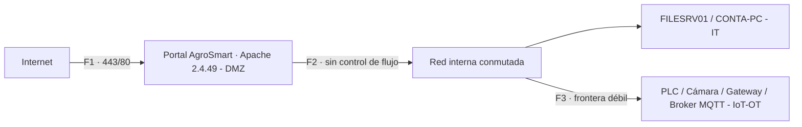

# Contexto y arquitectura — AgroSmart del Sumapaz S.A.S.

> Fuente: Anexo 1, Sec. 2.1 y 2.2 (págs. 9-10).

## 2.1 Contexto organizacional

Sector agroindustrial (Sumapaz, Cundinamarca). La organización opera un portal de pedidos
B2B, un segmento corporativo IT y un parque de dispositivos IoT/OT que controla el riego
automatizado. Creció rápido, conectó IoT de varios proveedores sin revisión de seguridad
formal, y publicó su portal en internet en las mismas condiciones (Sec. 2.1). Tu rol:
**analista que razona como atacante para defender**. No se explota nada: todo ocurre sobre
los artefactos del informe, dentro del Cyber Range del curso.

## 2.2 Arquitectura — tres dominios, tres fronteras

| Dominio | Qué contiene | Frontera |
|---------|--------------|----------|
| **DMZ / Web** | Portal AgroSmart LAMP (Apache 2.4.49 + MariaDB 10.3 + PHP 7.2.24) | **F1** · firewall perimetral hacia Internet (80/443) |
| **IT corporativo** | FILESRV01 (SMB/LDAP, dominio AGROSMART), CONTA-PC (RDP) | **F2** · sin control de flujo entre la DMZ y la red interna |
| **IoT / OT** | Gateway (Telnet/8080), cámara IP, PLC de riego (Modbus), broker MQTT | **F3** · frontera débil con IT: misma red interna conmutada, sin segmentación efectiva |

IT e IoT/OT comparten la misma red interna conmutada (Sec. 2.2 del Anexo lo dice
explícitamente: "la segmentación entre IT e IoT es débil"). La DMZ sí está detrás de un
firewall real, pero F2 (DMZ → red interna) tampoco tiene control efectivo — esa evidencia
sale de Sec. 3.8-3.9 (credencial reutilizada, sesión nula SMB), no de la Sec. 2.2.

### Diagrama lógico

El diagrama completo (con los 8 activos, las tres fronteras rotuladas y las notas técnicas
de cada segmento) ya está construido como formas nativas en la diapositiva 5 del
`.pptx` — no hace falta dibujarlo aparte. Versión mínima de referencia:

> [!tip] Dónde verificarlo
> Este diagrama responde al requisito explícito de la Sec. 2.2 del Anexo y del Paso 1 de
> la guía. Compáralo con la diapositiva 5 usando el checklist de
> [[00 - Contexto/Review - verificación paso a paso|la review]].
