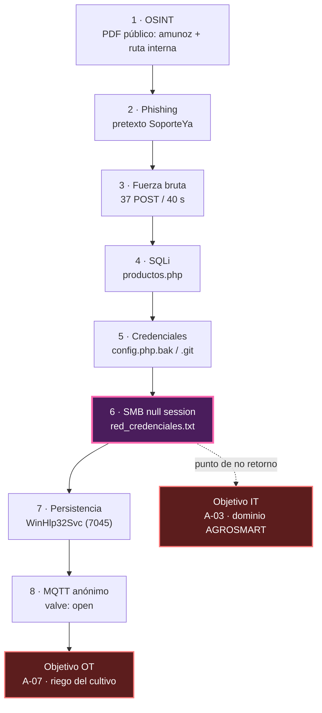

# 2.8 Ruta probable de ataque

> Anexo 1 pág. 29. Narra **paso a paso** la trayectoria más plausible: acceso inicial → escalamiento/lateralidad → objetivo en IT y OT/IoT. Acompaña con un **diagrama**. Cada salto cita la pista que lo habilita.

> [!note] Qué significa "probable" aquí
> El Anexo entrega **trazas parciales** (un banner, un evento 7045, una publicación MQTT),
> no una secuencia completa. Ninguna fila afirma que el adversario hizo esto; afirma que
> **los artefactos son consistentes con** que lo hiciera. Los pasos 7 y 8 (persistencia y
> publicación MQTT) son los de inferencia más fuerte: [[00 - Contexto/Glosario#Sysmon|Sysmon]] 3 atribuye la conexión a `:1883`
> al mismo `w.exe` que instaló el 7045, pero el Anexo no trae timestamps para ordenar los
> eventos ni prueba que ese proceso emitiera el `PUBLISH` concreto.

## Ruta paso a paso

| Paso | Descripción del salto | Habilitado por (pista) | Detección posible (insumo Reto 3) |
|------|----------------------|-----------------------|----------------------------------|
| **1** | **OSINT** previo: recopilan nombre de usuario `amunoz` y la ruta interna `\\FILESRV01\cotizaciones` desde un PDF público | Metadatos de PDF corporativo publicado (Sec. 3.4, 3.12) | No detectable por medios técnicos; control de publicación de documentos |
| **2** | **Phishing** al usuario de Contabilidad con pretexto de SoporteYa, dominio parecido y urgencia | Correo sospechoso reportado por Contabilidad (Sec. 3.4) | Filtro de dominio similar + regla de asunto; reporte de usuario |
| **3** | **Fuerza bruta** contra el login del portal: 37 POST fallidos en 40 s y luego un login exitoso | `access.log`; eventos 4625 y 4624; `LockoutThreshold 0` (Sec. 3.6) | **Alerta por tasa de fallos** sobre `/admin/login.php`; ese control no existe hoy |
| **4** | **Inyección SQL** en `productos.php` para extraer la base de datos de pedidos | `PDOException` / `mysqli_fetch_array()` línea 88 (Sec. 3.3c) | WAF con regla para errores de base de datos;parametrización de consultas en el código |
| **5** | **Credenciales** obtenidas de `config.php.bak` y del repositorio `.git` expuesto | Archivos accesibles sin autenticación (Sec. 3.8b-c) | **Regla de escaneo web** que bloquee y alerte de `.bak`, `.git` y listados de directorio |
| **6** | **Movimiento lateral SMB** con sesión nula desde A-01 hacia A-03, leyendo `respaldos/red_credenciales.txt` | SMBv1 sin firma y null session habilitada; `smbclient -N` (Sec. 3.9a-b) | Evento 5140/5145 con origen no esperado; **deshabilitar null session** |
| **7** | **Persistencia** en A-03 con el servicio `WinHlp32Svc` | Evento 7045; Sysmon 1 (`services.exe` crea `w.exe`) (Sec. 3.6) | **Regla directa y barata**: alertar ante cualquier 7045 |
| **8** | **C&C y publicación del comando**: el host comprometido publica `{"valve":"open"}` en `invernadero/riego/cmd` | Sysmon 3 `NetworkConnect` → `:1883`; `CONNECT anonymous` (Sec. 3.6, 3.11) | **Detección prioritaria**: alertar publicación anónima en tópicos de comando |

## Pista, hipótesis y evidencia para validar (Paso 7 de la guía)

| Salto | Pista del Anexo (lo observado) | Hipótesis (lo inferido) | Evidencia para validarla |
|-------|--------------------------------|-------------------------|--------------------------|
| 1 · OSINT | Metadatos de un PDF público: usuario `amunoz` y ruta `\\FILESRV01\cotizaciones` (Sec. 3.4, 3.12c) | El adversario eligió usuario y objetivo con datos públicos | Descargas del PDF desde 10.0.0.66 en los logs del portal |
| 2 · Phishing | Correo de falso «SoporteYa» reportado por Contabilidad (Sec. 3.4) | `amunoz` entregó o confirmó su credencial | Cabeceras del correo y consultas DNS al dominio parecido |
| 3 · Fuerza bruta | 37 POST a `/admin/login.php` en 40 s desde 10.0.0.66; `LockoutThreshold 0` (Sec. 3.6, 3.9c) | La credencial del panel se obtuvo por adivinación | Sesión de administrador abierta tras el último POST |
| 4 · SQLi | `productos.php?categoria=hortalizas'` devuelve 500 con error de mysqli (Sec. 3.3c, 3.6) | Se extrajo la base de datos de pedidos | Peticiones con carga SQL y consultas anómalas en MariaDB |
| 5 · Credenciales | `config.php.bak` y `/.git` accesibles sin autenticación (Sec. 3.8b-c) | La credencial expuesta se reutiliza en la red IT | GET a `/backup/config.php.bak` y `/.git/config` en `access.log` |
| 6 · Lateral SMB | 4625 ×12 y 4624 tipo 3 de `amunoz` **desde 10.10.10.20** (el servidor web); sesión nula (Sec. 3.9a-d) | El atacante pivota desde el portal (A-01) a FILESRV01 | Eventos 5140/5145 del share `respaldos` con el mismo origen |
| 7 · Persistencia | 7045 «WinHlp32Svc» → `C:\Windows\Temp\w.exe`; Sysmon 1 desde `services.exe` (Sec. 3.9d) | La instaló el mismo actor tras el logon de `amunoz` | Cuenta creadora del servicio, hash de `w.exe` y hora frente al 4624 |
| 8 · MQTT | Sysmon 3: **`w.exe` → 10.10.30.40:1883**; `PUBLISH {"valve":"open"}` (Sec. 3.9d, 3.11) | El mismo `w.exe` publicó la orden de riego | IP del cliente del PUBLISH y cambio de registro Modbus en el PLC |

> [!note] Correlación que el Anexo sí aporta entre los pasos 7 y 8
> Sysmon 3 identifica al **mismo proceso `w.exe`** que el evento 7045 instaló como servicio
> como origen de la conexión al broker. Eso une persistencia y C&C por el nombre del proceso;
> lo que falta para confirmarlo es la línea de tiempo (el Anexo no trae timestamps).

**Ruta alternativa y por qué no es la principal.** Técnica, sin persona: Apache 2.4.49
(CVE-2021-41773) → `config.php.bak` / `.git` → sesión nula SMB → `PUBLISH` en MQTT. Es más
corta y no necesita a nadie. Se prioriza la ruta con phishing porque sus saltos 3, 6, 7 y 8
tienen registro en los logs del Anexo; de la alternativa solo consta que Apache es explotable
(NSE), no que se haya explotado. Diapositiva 16 del entregable.

## El salto que decide la ruta

| Salto | Vector que lo habilita | Costo para el atacante | Consecuencia si falla |
|-------|------------------------|------------------------|----------------------|
| 2 → 3 | La credencial de `amunoz` (phishing) | minutos | Vuelve al paso 4, pero con SQLi necesita solo la web |
| 4 → 5 | El error de SQL filtrado | trivial | Puede repetirse sin credencial |
| 5 → 6 | Credencial de la BD reutilizada contra SMB | trivial | Requiere null session, que está abierta |
| 6 → 7 | Share `respaldos` legible | trivial | Ya está en A-03, la persistencia es rutina |
| 7 → 8 | Broker MQTT anónimo | **ninguno** | — |

> [!danger] Punto de no retorno
> El paso 6 es el **centro de la ruta**: es el primero que cruza de dominio (DMZ → IT)
> y el único del que se puede decir que todo lo anterior es reversible. Desde A-03 el
> atacante tiene credenciales de negocio, puede instalar persistencia y el broker MQTT
> ya no le pide nada. Cualquier control que se ubique antes del paso 6 vale más que
> cualquiera que se ubique después.

## Diagrama de la ruta

> [!note] El diagrama en la presentación
> La diapositiva 15 del entregable contiene este mismo recorrido como diagrama de formas
> nativas de PowerPoint (no imagen), con el paso 6 marcado como centro de la ruta.

---

Relaciona: [[2.4 Vectores de ataque]] · [[2.5 Ingeniería social]] · [[2.6 Cyber Kill Chain]] · [[2.7 MITRE ATT&CK]] · [[2.9 Impacto y riesgo]] · [[00 - Contexto/Contexto y arquitectura]]
